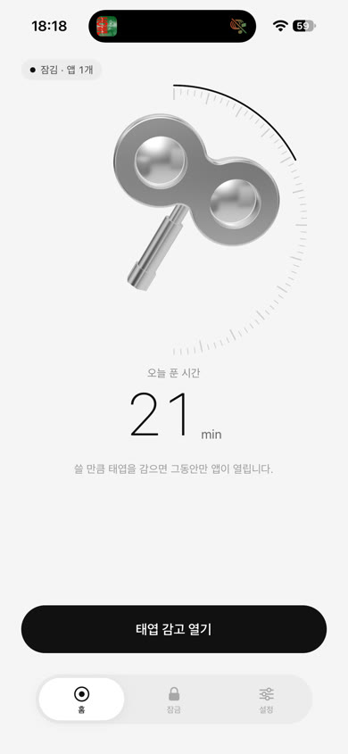
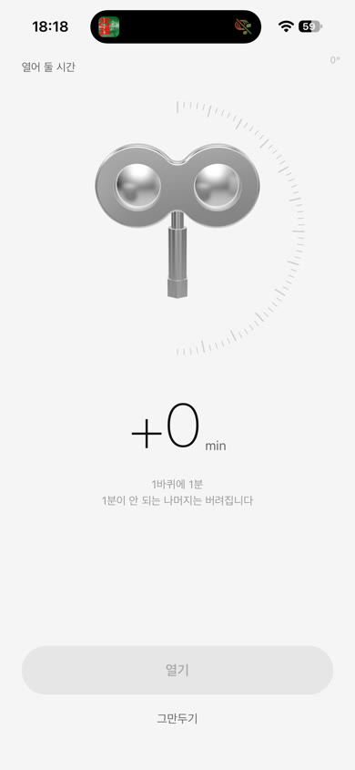
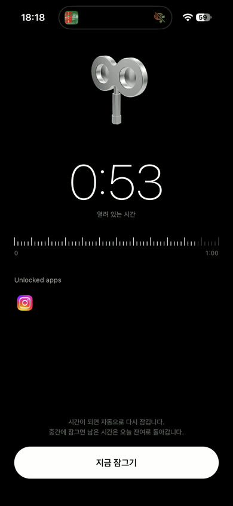
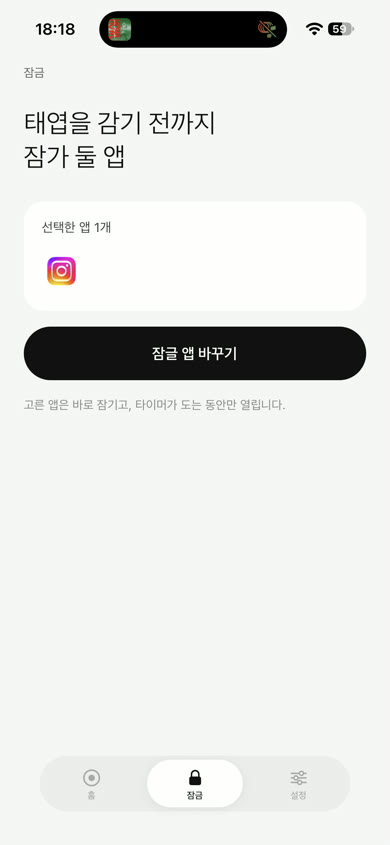
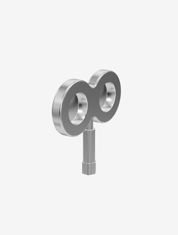
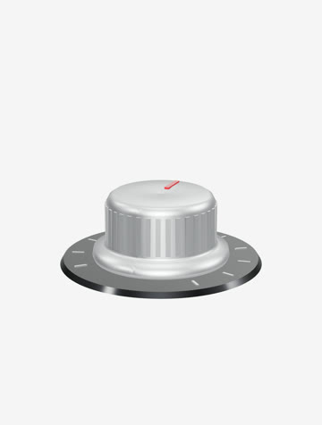
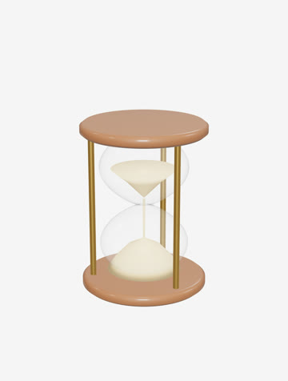

# 태엽 (windup-key)

태엽 열쇠를 감아야 SNS 가 열리는 앱. **1바퀴 = 1분.** 평소엔 잠겨 있고, 감은 시간만큼만 열린다.

Expo SDK 58 · React Native 0.88 · react-three-fiber(크롬 열쇠 3D) · Reanimated · Screen Time(FamilyControls)

| 홈 | 태엽 감기 | 열려 있는 시간 | 잠글 앱 |
|:-:|:-:|:-:|:-:|
|  |  |  |  |

*모든 스크린샷은 실기기(iPhone 15 Pro, iOS 27)에서 찍었다.*

## 3D 모델 갤러리

외부 모델 파일 없이 **기본 도형 조합 + 재질 프리셋 + RoomEnvironment 환경맵**만으로 만들었다.
태엽 열쇠를 만들며 다듬은 규칙을 [`docs/MODELING-PROMPT.md`](docs/MODELING-PROMPT.md) 로 일반화했고, 같은 프롬프트로 나머지 넷을 만들었다.
앱 안에서는 설정 → 3D 모델 갤러리.

| 태엽 열쇠 | 볼륨 다이얼 | 자물쇠 | 모래시계 | 메달 |
|:-:|:-:|:-:|:-:|:-:|
|  |  |  |  |  |
| 두 원 + 오목 필렛 압출, 구멍에 렌즈 회전체 / 크롬 | 단면 회전체 + 둘레 홈 36개 / 브러시드 알루미늄 | 둥근 사각 압출 + 반원 토러스 / 금·크롬 | 수식 단면 유리 회전체 + 모래 / 유리·나무·황동 | 테두리 솟은 회전체 + 별 양각 / 금·에나멜 |

코드: [`components/WindupKey.tsx`](components/WindupKey.tsx), [`components/models/`](components/models)

## 재사용 프롬프트

이 프로젝트의 진짜 산출물. 다른 앱에 그대로 붙여 쓴다.

- [`docs/MODELING-PROMPT.md`](docs/MODELING-PROMPT.md) — 3D 오브젝트 모델링 (공통 블록 + 오브젝트 템플릿 + 채운 예시 4개 + 증상별 수정 프롬프트)
- [`docs/MOTION-PROMPT.md`](docs/MOTION-PROMPT.md) — 순차 등장, 쓸리는 게이지, 스프링 버튼, 숫자 롤링, 되감기, 탭 알약 (수치 포함)

## 실행

```bash
npm install
npx expo prebuild --platform ios
npx expo start --dev-client
```

## ⚠️ 실기기 전용인 것들

- **앱 잠금(Screen Time)**: `modules/screen-time` 는 FamilyControls / ManagedSettings / DeviceActivity 를 쓰고 시뮬레이터에서 동작하지 않는다.
- **3D 크롬 질감**: iOS 시뮬레이터 GL 은 소프트웨어 렌더러라 환경맵(PMREM)·MSAA 에서 크래시한다. 시뮬레이터에선 자동으로 끄니 질감은 실기기로 확인.
- 확장 프로그램 3개(`ActivityMonitorExtension`, `ShieldConfiguration`, `ShieldAction`)와 App Group(`group.com.darby.windupkey`)은
  `react-native-device-activity` config plugin 이 prebuild 때 만든다(`targets/`).
- **TestFlight·스토어 배포에는 Apple 의 Family Controls (Distribution) 승인이 필요하다.**
  번들 ID 4개 각각 [신청 폼](https://developer.apple.com/contact/request/family-controls-distribution)을 따로 제출해야 한다.
  `com.darby.windupkey`, `.ActivityMonitorExtension`, `.ShieldAction`, `.ShieldConfiguration`

## 15분 미만 해제 구간

`DeviceActivitySchedule` 은 15분 미만이면 `intervalTooShort` 로 실패한다. 이 앱은 1~30분이라
시작을 과거로 당겨 길이를 맞춘다([`schedule.ts`](modules/screen-time/src/schedule.ts)):
`intervalStart = now - max(15 - N, 0)분`, `intervalEnd = now + N분`.
다시 잠그는 건 앱이 꺼져 있어도 되도록 DeviceActivityMonitor 익스텐션의 `intervalDidEnd` 가 한다.
실기기에서 1분 해제 → 62초 뒤 `intervalDidEnd` 확인.

## 만든 순서

[`PROMPTS.md`](docs/PROMPTS.md) 의 1~6단계를 단계마다 실기기 검증 후 커밋했다.
